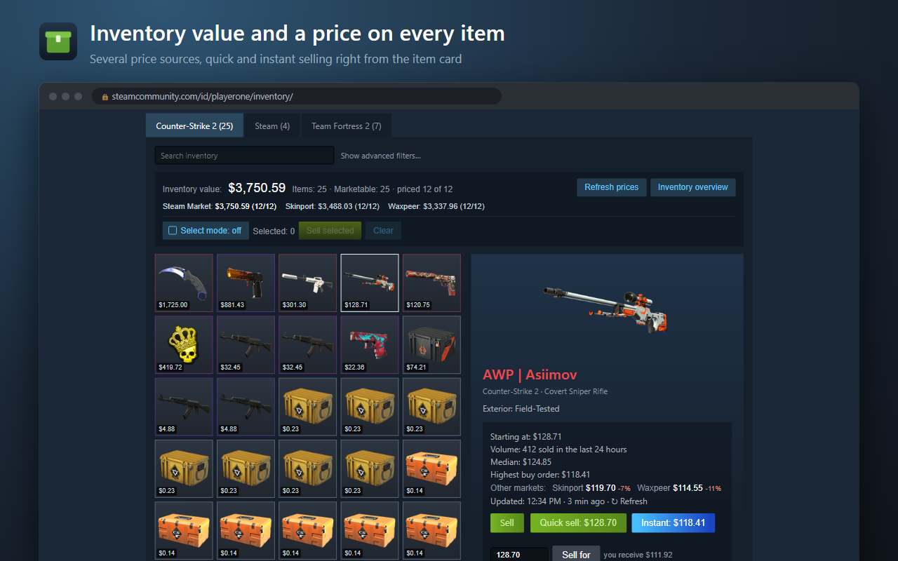
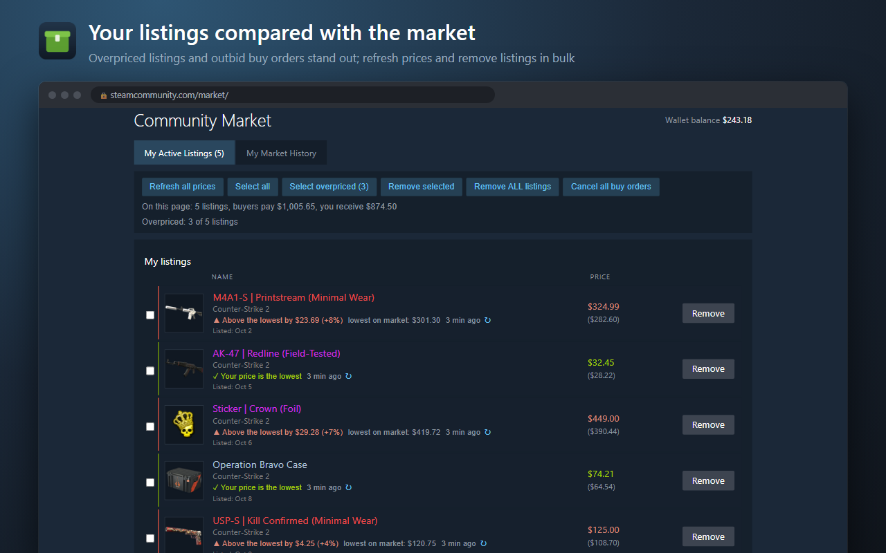
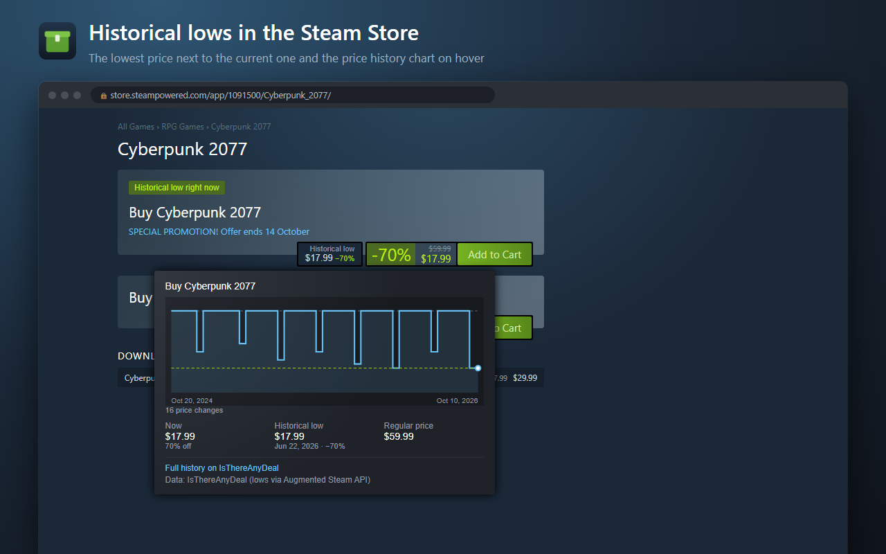
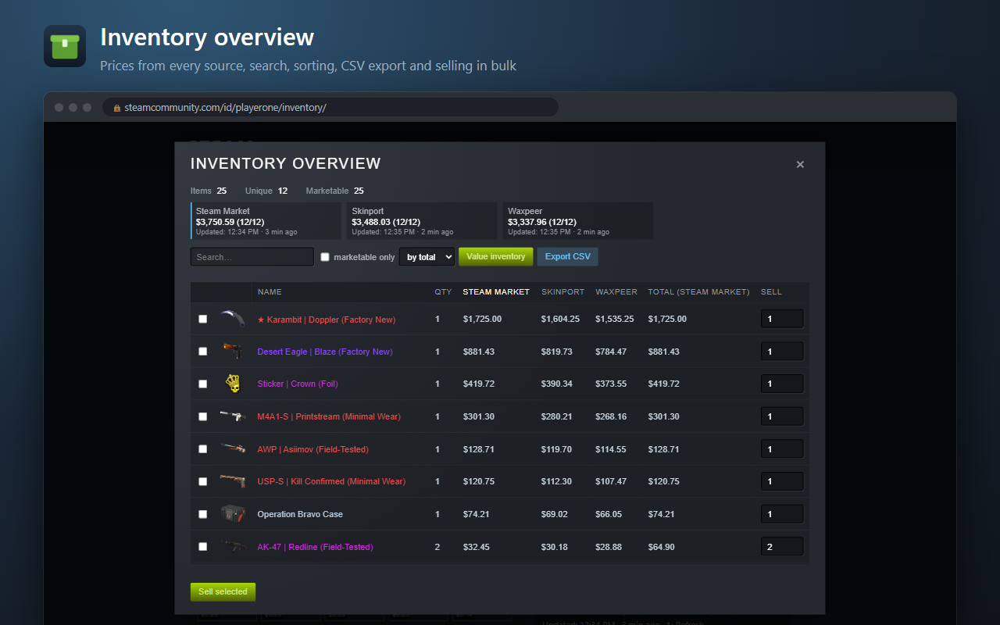
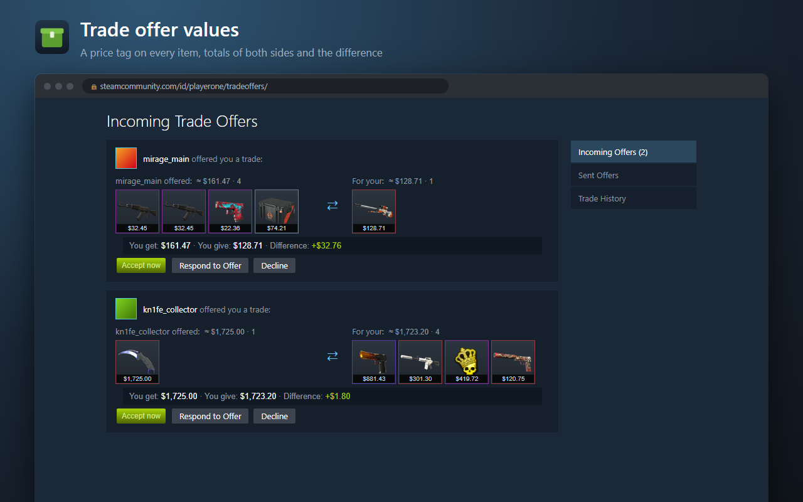

# Open Inventory Helper for Steam

A Chrome, Edge, Brave and Opera extension (Manifest V3) that adds prices, selling and trading tools right inside the Steam interface.
Open source, no ads, no analytics, no server of its own.

**[Install from the Chrome Web Store]([https://chromewebstore.google.com/detail/TODO](https://chromewebstore.google.com/detail/open-inventory-helper-for/eppdcljelkghimbchnlclklmcmkgkkpg))**

## Features

**Inventory**
- Inventory value is calculated automatically, and every item tile shows its price.
- Price sources: Steam Market, Skinport, Market.CSGO (TM), Waxpeer. Enable several and pick the primary one.
- The item card adds the median, the highest buy order, other marketplaces' prices, quick and instant selling, and suggested prices.
- Select mode and bulk selling. The inventory overview has search, sorting and CSV export.

**Community Market**
- Your listings and buy orders are compared with the market: overpriced listings and outbid orders stand out.
- Refresh prices for all listings or for one. Remove listings and cancel buy orders in bulk.
- On item pages: sales stats for 24 hours, 7 and 30 days, and quick buy.

**Steam Store**
- The historical low next to the price of games, DLC, packages and bundles, plus a "Historical low right now" label.
- Hovering the price opens the price history chart (needs a free IsThereAnyDeal key).

**Trades**
- A price tag on every item, totals of both sides and the difference, in the trade window and in the offers list.
- Add several items by name and an "Accept now" button.
- Incoming offers badge on the icon and desktop notifications.

| | |
|---|---|
|  |  |
|  |  |

## Privacy

- Requests go only to Steam and to the services you enable yourself: Augmented Steam (lows and exchange rates), IsThereAnyDeal (with your key) and the marketplaces you use as price sources.
- Settings and the price cache stay in your browser. Remote code is blocked by `script-src 'self'`.
- Selling, buying and trades run in your own Steam session. Confirmation in the Steam mobile app is still required.

Details: [PRIVACY.md](PRIVACY.md).

## Install from source

1. Open `chrome://extensions` (`edge://extensions` in Edge) and turn on developer mode.
2. Click "Load unpacked" and select the project folder.

Requires Chromium 111 or newer.

## License

[MIT](LICENSE)

Not affiliated with Valve Corporation. Steam and the Steam logo are trademarks of Valve Corporation.
